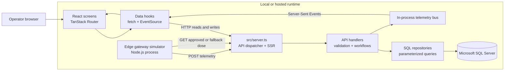
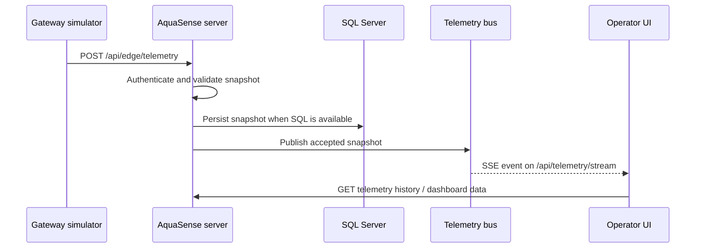
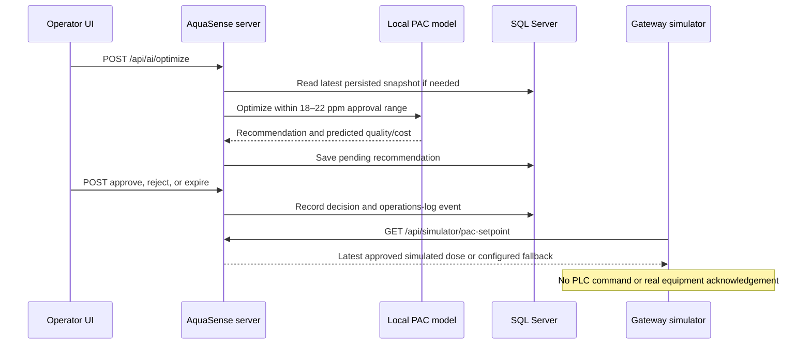

# AquaSense AI

AquaSense AI is a web MVP for demonstrating water-treatment plant monitoring and operator workflows. It combines simulated edge telemetry, process-quality indicators, alerts, PAC dose recommendations, an operations log, shift handovers, CSV history import, and manually recorded operating costs. It is a demonstration system: telemetry and setpoint application are simulated, and approvals never control physical equipment.

## Contents

- [Architecture](#architecture)
- [Routes and screen components](#routes-and-screen-components)
- [HTTP API](#http-api)
- [Data model and persistence](#data-model-and-persistence)
- [External services and system boundaries](#external-services-and-system-boundaries)
- [Configuration and local startup](#configuration-and-local-startup)
- [Development and validation](#development-and-validation)
- [Repository map](#repository-map)

## Architecture

The application uses TanStack Start/Router for server rendering and file-based routes, React for the UI, a custom server dispatcher for API requests, SQL Server for durable records, and a Node-based edge simulator. `src/server.ts` handles the API paths first; requests that are not API calls continue to TanStack Start's server renderer.



### Main workflows





When SQL Server is unavailable, an accepted telemetry snapshot can be kept in a bounded in-memory history and sent to connected browsers. Such a snapshot is temporary and is not part of SQL history. Other workflows that require durable writes report that they could not be saved.

## Routes and screen components

The root URL `/` redirects to `/bitacora`. File routes in `src/routes/` set page metadata and mount the corresponding screen component.

| Route              | Screen/component               | Purpose and behavior                                                                                                                                                                                                                                  |
| ------------------ | ------------------------------ | ----------------------------------------------------------------------------------------------------------------------------------------------------------------------------------------------------------------------------------------------------- |
| `/costos`          | `CostosScreen`                 | Main dashboard: latest process readings, rolling statistics, PAC and effluent trends, compliance distribution, local PAC optimization, and monthly energy/sludge/membrane cost entry and history. `DashboardMetric` is its reusable colored KPI card. |
| `/alertas`         | `AlertasScreen`                | Lists plant alerts, filters by status, and lets an operator pause, resolve, or reopen an alert.                                                                                                                                                       |
| `/recomendaciones` | `RecomendacionesScreen`        | Runs the PAC optimizer, compares predicted dose and quality, shows recommendation history, and supports approve/reject/expire/revoke. Approval requires a persisted recommendation, predicted compliance, and a dose in the 18–22 ppm range.          |
| `/bitacora`        | `BitacoraScreen`               | Lists operational events, exports them to CSV, records a measured shift handover, and displays handover history and operator attribution.                                                                                                             |
| `/carga-csv`       | `CargaCsvScreen` + `CsvReview` | Loads and previews a complete-snapshot CSV, reports row/header validation issues, and submits valid imports. The file limit is 5 MB.                                                                                                                  |

### Shared and supporting components

- `ScadaShell` provides the sidebar, navigation, live/simulation status, and open-alert count around the operational pages.
- `TopBar` provides plant and shift selection, signal status, operator context, and a quick alert menu.
- `CsvReview` owns file selection/drop, local preview, template download, and import result feedback; `CargaCsvScreen` supplies its page heading and layout.
- `Chart` (`src/components/ui/chart.tsx`) provides theme-aware Recharts wrappers. The dashboard also uses Recharts directly for trend, distribution, and monthly cost charts.
- `src/components/ui/` contains small reusable presentation wrappers for controls and interaction patterns: accordion/collapsible, alert/dialog, aspect ratio, avatar, badge, breadcrumb, button, calendar, card, carousel, checkbox, command, context menu, drawer, dropdown menu, form, hover card, input/OTP, label, menubar, navigation menu, pagination, popover, progress, radio group, resizable panels, scroll area, select, separator, sheet, sidebar, skeleton, slider, sonner/toasts, switch, table, tabs, textarea, toggle/group, and tooltip. These primitives do not implement plant business rules.

### Hooks and shared client logic

- `useApiData` loads JSON, exposes loading/error state, supports explicit refresh, and optionally polls.
- `useLiveTelemetry` opens `/api/telemetry/stream` with `EventSource`, tracks the latest reading and connection state, and reconnects after stream errors.
- `app-context-store` holds the selected plant and shift in browser memory. Plant labels map to `PL_NORTE`, `PL_SUR`, and `PL_ORIENTE`.
- `api-client.ts` centralizes typed request helpers and records for telemetry, alerts, recommendations, operations, handovers, and costs.
- `lib/csv.ts` parses CSV, detects comma/semicolon delimiters, normalizes headers, validates required/optional fields and value ranges, and creates a downloadable template.
- `lib/dose-validation.ts` defines the shared 18–22 ppm approval band and the projected-quality approval check.

## HTTP API

All endpoints are dispatched from `src/server.ts`. Operations endpoints are implemented by `src/server/api/operations.ts`; specialized telemetry, CSV, and recommendation workflows have dedicated handlers. Query endpoints accept `plantCode`, `limit` (1–200), and `offset` where applicable.

| Method and path                                 | Function                                                                                                                                                                                  |
| ----------------------------------------------- | ----------------------------------------------------------------------------------------------------------------------------------------------------------------------------------------- |
| `POST /api/edge/telemetry`                      | Accepts one validated telemetry snapshot from the gateway. Requires `X-Edge-Gateway-Key`. Writes to SQL when available, publishes to SSE, and returns whether the snapshot was persisted. |
| `GET /api/telemetry/stream`                     | Opens an SSE stream. Sends the latest in-process snapshot or a waiting status, then new telemetry events and 15-second heartbeat comments.                                                |
| `GET /api/telemetry/history`                    | Returns paginated persisted telemetry snapshots for a plant.                                                                                                                              |
| `POST /api/telemetry/import-csv`                | Accepts `text/csv`, validates complete snapshots, and imports accepted rows transactionally. Requires same-origin request and configured operator identity.                               |
| `GET /api/alerts`                               | Lists plant alerts and reopens alerts whose pause period expired.                                                                                                                         |
| `POST /api/alerts`                              | Creates an alert; requires same-origin request and operator identity.                                                                                                                     |
| `PATCH /api/alerts/{id}`                        | Updates alert status (`abierta`, `pausada`, `resuelta`), with optional future pause time; requires same-origin request and operator identity.                                             |
| `GET /api/ai/recommendations`                   | Lists recommendation history for a plant.                                                                                                                                                 |
| `POST /api/ai/optimize`                         | Reads current process conditions, runs the local model, and stores a pending recommendation when SQL is available.                                                                        |
| `POST /api/ai/recommendations/approve`          | Approves or rejects a pending recommendation and writes an operations-log event. Requires operator identity and same-origin request.                                                      |
| `POST /api/ai/recommendations/expire`           | Expires a pending recommendation and logs the action.                                                                                                                                     |
| `POST /api/ai/recommendations/revoke`           | Withdraws an approved recommendation for subsequent simulator cycles and logs the change.                                                                                                 |
| `GET /api/simulator/pac-setpoint?plantCode=...` | Gateway-only endpoint. Returns the latest approved recommendation or `PAC_INITIAL_SETPOINT`; requires the gateway key. It never reports a physical PLC acknowledgement.                   |
| `GET /api/operations-log`                       | Returns paginated operation events.                                                                                                                                                       |
| `GET /api/shift-handovers`                      | Lists recorded shift handovers.                                                                                                                                                           |
| `POST /api/shift-handovers`                     | Saves a measured shift handover and integrity hash; requires same-origin request and operator identity.                                                                                   |
| `GET /api/operational-costs`                    | Lists monthly cost entries for the selected plant.                                                                                                                                        |
| `POST /api/operational-costs`                   | Inserts or updates one monthly entry with energy, sludge, and membrane costs, optional source note, and operator attribution. Requires same-origin request and operator identity.         |
| `GET /api/operator/context`                     | Reports whether `OPERATOR_NAME` and `OPERATOR_ROLE` are configured; does not return secrets.                                                                                              |

Mutating browser workflows check the request origin. Gateway endpoints compare the shared key using a constant-time comparison. Database access stays on the server and uses parameterized SQL through `mssql` repositories.

## Data model and persistence

`database/02_schema.sql` defines these SQL Server entities:

| Table                    | Purpose                                                                                                                              |
| ------------------------ | ------------------------------------------------------------------------------------------------------------------------------------ |
| `Plants`, `Shifts`       | Plant and shift lookup records.                                                                                                      |
| `ScadaTags`              | Plant instrumentation catalog and expected tag ranges.                                                                               |
| `TelemetrySnapshots`     | Complete, timestamped inflow, PAC, reactor, effluent, compliance, and quality-flag samples.                                          |
| `AiRecommendations`      | Model input/result summary, confidence, projected quality/savings, and approval state.                                               |
| `OperationalAlerts`      | Plant alert details, status, pause, resolution, and resolution attribution.                                                          |
| `OperationsLog`          | Recommendation/alert/system events with operator and application status.                                                             |
| `ShiftHandovers`         | Shift totals and measured closing values with operator attribution and integrity hash.                                               |
| `OperationalCostRecords` | One monthly USD cost record per plant, separated into energy, sludge, and membranes. Corrections update the same plant/month record. |

The SQL repositories live in `src/server/db/`: `telemetry-repository.ts`, `recommendations-repository.ts`, `operations-repository.ts`, and `costs-repository.ts`. `client.ts` creates and reuses the SQL Server connection pool, checks the active database context, and logs connection diagnostics. `errors.ts` distinguishes unavailable persistence from other failures.

### Model and measurement semantics

- The local model is `src/server/ai/surrogate-model.ts`; it has no cloud AI dependency. It estimates effluent quality and PAC savings from supplied process conditions and searches only the shared approval dose range.
- The dashboard calculates statistics from up to 200 latest persisted samples. Its references are 4 NTU turbidity and 60 mg/L DQO, as encoded in the application. They are app reference thresholds and should not be treated as a complete regulatory determination for a real site.
- PAC savings are model projections. Energy, sludge, and membrane costs are manually transcribed monthly from invoices/reports, stored in USD, and shown separately; they are not derived from telemetry.
- `03_seed_data.sql` and `04_seed_demo_excursions.sql`, `06_seed_demo_operational_costs.sql`, and `07_seed_demo_operations_and_handovers.sql` supply demonstration records. Synthetic demo data must not be presented as plant measurements.
- CSV imports accept complete process snapshots, not isolated individual tags. Batch imports use a SQL transaction; if the batch cannot be saved, the UI reports that no rows were saved.

## External services and system boundaries

| Service/system                             | Use in this MVP                                                                                                                                                                           | Not provided                                                                       |
| ------------------------------------------ | ----------------------------------------------------------------------------------------------------------------------------------------------------------------------------------------- | ---------------------------------------------------------------------------------- |
| Microsoft SQL Server                       | Durable telemetry, recommendations, alerts, log, handovers, and cost records.                                                                                                             | Automatic database provisioning beyond the supplied SQL scripts.                   |
| Google Fonts and Material Symbols          | Remote typography and sidebar icons loaded by the root document.                                                                                                                          | Required for database or model behavior.                                           |
| Browser `EventSource` / Server-Sent Events | Pushes accepted telemetry from this server process to connected UI clients.                                                                                                               | A broker or cross-process/distributed event bus.                                   |
| Edge gateway simulator                     | Generates synthetic process values every five seconds, gets PAC setpoint, and posts telemetry. `SIMULATION_PROFILE=demo` emits a labeled excursion every 12 cycles; `stable` disables it. | PLC, OPC-UA, Modbus, real sensor/device connectivity, or physical acknowledgement. |
| Local PAC estimation model                 | In-process deterministic approximation for recommendation demonstration.                                                                                                                  | OpenAI or other hosted AI inference.                                               |

The telemetry bus is in-process memory. A multi-instance deployment would need shared event transport and a deployment-specific persistence/availability design before SSE fan-out could be considered cross-instance.

## Configuration and local startup

Requirements: Node.js 22.12+ and npm. From the repository root:

```powershell
npm ci
if (!(Test-Path .env)) { Copy-Item .env.example .env }
```

Keep `.env` local and never commit credentials. Configure:

| Variable                                                    | Purpose                                                                                                                 |
| ----------------------------------------------------------- | ----------------------------------------------------------------------------------------------------------------------- |
| `DB_SERVER`, `DB_PORT`, `DB_NAME`, `DB_USER`, `DB_PASSWORD` | SQL Server connection. The normal database name is `AquaSenseSCADA`.                                                    |
| `DB_ENCRYPT`, `DB_TRUST_SERVER_CERTIFICATE`                 | SQL TLS/certificate behavior.                                                                                           |
| `EDGE_GATEWAY_KEY`                                          | Shared gateway key; must contain at least 32 characters.                                                                |
| `PLANT_CODE`                                                | Plant sent by the gateway, e.g. `PL_NORTE`.                                                                             |
| `TARGET_URL`                                                | Gateway telemetry target; defaults to `http://localhost:3000/api/edge/telemetry`.                                       |
| `PAC_INITIAL_SETPOINT`                                      | Fallback simulated dose, 5–50 ppm, used when there is no approved dose to read.                                         |
| `SIMULATION_PROFILE`                                        | `demo` (default) or `stable`. Demo adds a synthetic quality excursion on each 12th cycle and labels it in gateway logs. |
| `OPERATOR_NAME`, `OPERATOR_ROLE`                            | Server-side identity attached to audited writes. Both are required for operator actions.                                |

Initialize SQL Server using [database/README.md](database/README.md). For an existing installation missing the costs table, run `database/05_add_operational_cost_records.sql`. Optional demo-only seeds include `04_seed_demo_excursions.sql`, `06_seed_demo_operational_costs.sql`, and `07_seed_demo_operations_and_handovers.sql`. The cost and operations seeds preserve existing cost periods and handover records; sample handovers are left uncertified.

Run the web app and gateway in separate terminals:

```powershell
npm run dev
npm run gateway
```

`npm run gateway:simulate` is an alias for the gateway simulator. The gateway logs profile, setpoint source, SQL persistence state, and each synthetic cycle. SQL diagnostics are emitted by the web server terminal.

## Development and validation

```powershell
npm test                 # Run Vitest suite
npm run test:watch       # Run Vitest in watch mode
npm run lint             # ESLint and configured formatting rules
npx tsc --noEmit         # Type-check without emitting files
npm run build            # Production build
npm run preview          # Serve the production build locally
```

Tests are under `src/test/`. Add/adjust tests for API validation, recommendation constraints, and data transformations when changing those behaviors. `src/routeTree.gen.ts` is generated by TanStack Router; do not hand-edit it.

## Repository map

```text
src/
  routes/                 File-based page routes and root document
  components/screens/     Dashboard and operational workflows
  components/ui/          Reusable interaction/presentation primitives
  hooks/                  API loading and live telemetry subscriptions
  lib/                    Types, client API, CSV parsing, state, validation
  server/api/              HTTP handlers and request validation
  server/ai/               Local PAC prediction/optimization
  server/db/               SQL connection and repositories
  test/                    Vitest tests
scripts/                  Edge gateway simulator
database/                 SQL setup, schema, migrations, and demo seeds
```

When contributing, keep SQL in repositories, request validation in API handlers, and plant workflows in screen components. Reuse the existing UI primitives and shared types; describe behavior and checks in pull requests, and include screenshots for visual changes.
